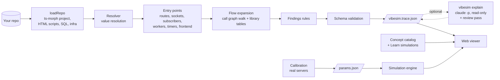

# vibeSimulator architecture

vibeSimulator turns a JavaScript or TypeScript backend repository into a **trace**: every path a request, timer or message takes through the code, with the line that proves each hop. A static web app plays those paths, flags scale risks, and simulates load. This document explains how the pieces fit. For running it, see [USAGE.md](USAGE.md).

## Principles

These decide most design questions:

1. **Evidence or nothing.** Every node and edge carries at least one `file:line`. If the parser can't prove a hop, it emits an *unresolved* hop with the reason, never a guess.
2. **Deterministic core, optional AI on top.** The same repo always produces the same trace, with no AI and no API key. Graph edges are only ever `verified` by the parser (or `unresolved`). An optional, separate step (`vibesim explain`) adds AI notes in their own section of the trace; they never change the graph or the findings, and the viewer always labels them.
3. **Local only.** The analyzer reads files and never executes them. The viewer is a static site; a user's trace stays in their browser tab.
4. **Measured, not assumed, where it matters.** Simulation parameters for realtime transports come from real Node servers on real hardware, checked against measurements the fit never saw.
5. **Bounded depth.** The viewer goes three levels deep (flow → hop inspector → concept drawer with its scene) and stops.
6. **Paced for reading.** Playback waits on the reader, not the other way round: each step holds long enough to read, and nothing scrolls the page by itself.

## The pipeline

Everything to the left of the trace file runs in Node via the CLI (`apps/cli`). Everything to the right runs in the browser.

## Packages

| Package | Responsibility | Key files |
|---|---|---|
| `packages/spec` | Trace Spec v1: the JSON format, zod schemas, cross-reference checks, generated JSON Schema | `src/schema.ts`, `src/validate.ts`, `schema/trace-spec.v1.schema.json` |
| `packages/extractor` | Static analysis: repo → trace. Also the accuracy harness, and the prompts and citation checks for AI notes | `src/analyze.ts`, `src/values.ts`, `src/libraries.ts`, `src/functions.ts`, `src/notes.ts`, `eval/` |
| `packages/findings` | Deterministic scale-risk rules over a trace | `src/rules.ts` |
| `packages/sim` | Discrete-event engine, calibrated parameters, whole-flow simulation for Scale mode | `src/engine.ts`, `src/params.json`, `src/flowsim.ts` |
| `packages/catalog` | Concept registry (34 concepts, each with an animated scene and a page; the 12 core ones also have a calibrated simulation) | `src/concepts.ts`, `src/pages.ts`, `src/extra-pages/`, `src/scenes/`, `src/sims/` |
| `apps/cli` | `vibesim analyze`, `vibesim explain` | `src/main.ts` |
| `apps/web` | The static viewer (Vite + React) | `src/pages/`, `src/components/`, `src/lib/` |
| `calibration` | Real servers and load generators that produce `params.json` | `server.mjs`, `client.mjs`, `run.ts`, `REPORT.md` |
| `fixtures/repos` | Ground-truth repos for tests and the gallery | one folder per repo |

The repo is a pnpm workspace. Everything is TypeScript run directly by Node 24's type stripping, so there is no build step outside the web app. That is why the code uses `.ts` import extensions and avoids TypeScript-only syntax such as parameter properties (`erasableSyntaxOnly`).

## Trace Spec v1

A trace is one JSON document (`schemaVersion: "1"`):

| Field | What it holds |
|---|---|
| `meta` | Generator name and version, repo name and commit, detected frameworks, counts |
| `services` | Deployable processes and datastores (HTTP servers, workers, frontend, proxies, compose services) |
| `nodes` | Participants. `kind` is one of: client, ui-event, timer, proxy, route, ws-endpoint, sse-endpoint, middleware, handler, service, worker, database, cache, queue, topic, external-api, compute, unknown |
| `edges` | Hops between nodes. Each has a `protocol` (in-process, http, ws, sse, grpc, sql, mongodb, redis, amqp, kafka, smtp, unknown), a `lifecycle` (none, new-per-request, pooled, held, keep-alive, persistent, unknown), a `mode` (sync or async), and `props` with facts such as the SQL statement, Redis command, `inLoop`, `parallel`, `errorPath`, `notAwaited`, the `branchPath` of conditions it runs under, `checkout`/`release` for a held connection, `hook` (a Mongoose pre-save hook) and `sleepMs` (a deliberate wait) |
| `flows` | Ordered walks of edges from one entry node: the paths the viewer plays |
| `findings` | Scale risks with severity, consequence, fix, concept link, evidence and rule-specific `data` |
| `gaps` | What couldn't be resolved, and why. Every unresolved node or edge is covered by a gap |
| `notes` | Optional AI notes: per-flow summaries and insights, each with checked citations, plus who wrote them and how they were reviewed |

Every node, edge, service, finding and gap has `evidence`: a list of `{ file, line, snippet?, context? }`, where `context` holds up to 24 surrounding source lines (omitted with `--no-source`). Nodes and edges also carry `confidence` (verified / inferred / unresolved), `source` (parser / llm / manual) and `concepts` (catalog slugs).

`validateTraceSpec` checks the shape and the cross-references: ids are unique, edges point at existing nodes, each flow is a connected walk from its entry (an edge may repeat, since a function called twice makes its calls twice), every unresolved item has a gap, flows reference real services, and AI notes reference real flows. The viewer runs the same validation on every file it opens. Run `pnpm --filter @vibesim/spec build:schema` to regenerate the JSON Schema after changing the zod schema.

## Extractor

`analyzeRepo(root)` in `packages/extractor/src/analyze.ts` runs five stages.

### 1. Load (`project.ts`)

Builds a ts-morph project from every JS/TS file, honoring `tsconfig` path aliases. Inline `<script>` blocks in HTML files become virtual source files with their original line numbers preserved, so browser code is analyzed like any other module. `.sql` files are parsed for tables, unique keys and indexes (`sqlschema.ts`). `infra.ts` reads `package.json` scripts, Dockerfiles, `docker-compose.yml` and Nginx configs.

### 2. Resolve values (`values.ts`)

The `Resolver` answers "what is this expression, really?" for any node in the code. A value is one of: function, module, external (an npm package export), global, object, class, instance, handle, member, string, collection, result, choice (several possibilities) or unknown.

The important one is **handle**: a live client created by a library call, such as `new Pool()`, `createClient()`, `new PrismaClient()` or `axios.create()`. A handle is identified by its creation site, so the same `pool` imported into ten files is recognized as one database connection pool. Resolution follows CommonJS and ESM exports, re-exports, classes and `this`, function parameters (by looking at every caller), arrays and sets filled with `push`/`add` and then iterated, and wrapper functions (`originOf` unwraps `asyncHandler(fn)`-style wrappers).

### 3. Library knowledge (`libraries.ts`)

Two tables turn handles into infrastructure:

- **Creators** say which calls create a handle and what it is: `pg`'s `Pool` makes a pooled Postgres handle, `ws`'s `WebSocketServer` a socket endpoint, BullMQ's `Queue` a queue, and so on for Prisma, Mongoose, Drizzle, MySQL, Supabase, node-redis, ioredis, socket.io, S3, axios, nodemailer and outside SDKs.
- **Operations** (`classifyOp`) say what a method call on a handle does: `pool.query(sql)` is a SQL statement (parsed by `sql.ts` for statement type, tables, WHERE columns and joins), `redis.zadd` is a Redis command, `queue.add` is an enqueue, `ws.send` is a push.

A `COMPUTE` table covers CPU-heavy calls such as bcrypt (`bcrypt`, `bcryptjs`, `@node-rs/bcrypt`), argon2 and zlib, recording whether they block the event loop or run on the libuv thread pool.

Supporting a new library usually means adding rows to these tables, not new analysis code.

### 4. Entries and flows

Entry points are collected first: Express routes with their middleware chains, including mounted and chained routers (`express.ts`); Next.js route handlers, pages and Server Actions (`nextjs.ts`); WebSocket connection handlers; Redis subscribers; queue consumers; `setInterval`/`setTimeout` loops; and frontend code (button handlers, `useEffect`, polling timers, `new WebSocket`), which is matched to the repo's own routes.

From each entry, `expand` walks the call graph. Calls into your own functions become in-process edges into handler, service or worker nodes. Calls on handles become network edges to database, cache, queue, topic or external-api nodes, with protocol and lifecycle from the library tables. Callback arguments are bound per caller, so a shared helper called from two routes is followed correctly in each.

`callSites` (`functions.ts`) records, for each call, the facts the viewer and the rules need:

- **Conditions.** The chain of `if`/`else`, `switch` and `?:` it sits under. An `if` whose body always leaves (`return`, `throw`, `break`) turns the rest of the function into its `else` side; when that body does no work of its own (`if (!user) return res.status(404)…`) it is a guard clause. The viewer plays the rest of the function by default in both cases.
- **Waiting.** Whether the caller waits for it (`await`, `return`, `.then`, `Promise.all`), so a forgotten `await` on a promise shows as fire-and-forget and a plain synchronous call doesn't.
- **Loops, parallelism, error paths.** Whether it runs in a loop (and whether the loop exits early), in parallel, or only in a `catch` block.

`responsesOf` reads how each handler answers (`res.status(201).json(job)`, `res.redirect`, `next(err)`) with the conditions under which it does. A few library behaviours are modelled because they change what really runs: express-session's session read and end-of-request save, Passport's `deserializeUser` and strategy callbacks, OAuth token and profile calls, a `pg` client checked out of the pool and released, Mongoose `pre('save')` hooks (shown only when the code sets the field the hook waits for, such as `password`), deliberate `setTimeout` sleeps, and functions that read or change state kept in the process's memory. The findings and the simulation use the same facts.

When resolution fails (a runtime-built URL, an unknown package, a dynamic `require`), the walk emits an unresolved node and a gap with the reason, then continues with the rest of the flow.

### 5. Finish

Services are derived from entry files and infrastructure. Findings run over the assembled graph, and the result is validated against the spec before it is returned.

### Accuracy harness (`eval/`)

Each fixture repo has a hand-labeled truth file listing every expected route, middleware chain and edge as `from -> to @ file:line` (with `let` aliases for readability). `score.ts` compares a fresh trace against it and reports precision and recall per repo. `pnpm --filter @vibesim/extractor eval` fails if any repo drops below 90% precision or 85% recall. `eval:blind` runs the same scoring on third-party repos that were labeled before the analyzer ever saw them; their first-run numbers are recorded in `eval/blind/README.md` and are the honest measure of how the extractor generalizes.

## Findings

`runFindings(spec)` in `packages/findings/src/rules.ts` is a list of pure functions over the trace graph. Each rule matches a pattern of nodes, edge kinds and props and emits a finding with severity, a consequence in plain words, a fix, a concept link and the evidence of the hop that causes it. Rules:

`db-call-in-loop`, `connection-per-request`, `unbounded-query`, `external-call-in-request-path`, `polling-via-timer` (also `worker-idle-polling`), `cpu-on-request-path` (reported as `cpu-blocking-event-loop` or `threadpool-saturation`), `push-triggers-fetch`, `in-memory-state`, `rate-limit-in-memory`, `websocket-no-backplane`, `full-table-aggregate`, `missing-index`, `sort-without-index`, `redundant-index`, `db-per-request-middleware`, `static-after-session`, `check-then-insert`, `redis-check-then-act`, `dual-write`, `bulk-insert-params`.

Rules that need the database schema (`missing-index`, `sort-without-index`, `redundant-index`) use the parsed `.sql` files. A loop with an early exit is downgraded. Browser-side nodes are skipped by server-only rules. Every rule has positive and negative tests, and the expected findings for each fixture repo are pinned in `test/findings.test.ts`.

## Simulation

### Engine (`packages/sim/src/engine.ts`)

A small discrete-event simulator. Processes are generator functions that `yield` operations: wait for a time, acquire a `Resource` (a pool of identical units with a FIFO queue: CPU cores, connections, threads), or wait on a `Signal`. `Histogram` records latencies and percentiles. The random generator is seeded (mulberry32), so every run is reproducible. Tests check the engine against closed-form queueing results: M/M/1, Erlang C (M/M/c) and M/D/1.

### Calibration (`calibration/`)

`server.mjs` runs real endpoints for short polling, long polling, SSE and WebSockets. `client.mjs`, in a separate process, holds thousands of connections or sends requests at fixed rates. `run.ts` measures memory per connection and CPU per message and request at several scales, fits a fixed-plus-marginal cost model, and validates the fit at scales it wasn't trained on. Every check must land within ±25%. The output is `packages/sim/src/params.json` and the human-readable `calibration/REPORT.md`.

### Concept scenes (`packages/catalog/src/scenes/`)

Every concept opens on an animated scene in a network-simulator style. A scene is plain data plus a small agent model: `layout(params)` returns boxes and links, and `start(params, seed)` returns a run whose `tick(ms)` advances a `World` (envelopes moving along links with arrival callbacks, timers, a seeded random source and a short log) and reports each box's state (slots in use, a line of waiting work, a note), the tokens in flight, counters and the log. `Station` models anything with fixed capacity and a FIFO line: server slots, pool connections, workers, threads. Scenes have 2 to 4 plain controls and "Try this" experiments that set them. Timings are slowed down to watch, and counters that quote real-world numbers say so. Tests run every scene and every experiment for 30 to 90 s of scene time, check that tokens use real links and boxes never overlap, and assert the mechanism (long polling sends fewer requests than short polling, batched N+1 makes 2 queries, a synchronous hash makes quick requests wait). Every experiment's promise is tested with the seed the page uses, so what the sentence says is what the reader sees. `apps/web/src/components/ConceptScene.tsx` renders them, labels each packet when few are in flight, and pauses scenes that are off screen; a browser test samples every scene and experiment and fails if any box's text is cut off or spills out.

### Learn simulations (`packages/catalog/src/sims/`)

One module per concept (realtime transports, pooling, queues, pub/sub, load balancing, caching, N+1, concurrency models, connection lifecycle). Each exposes at most three knobs and returns metrics and charts. The realtime and pub/sub models use the calibrated parameters, and a test checks the realtime model against the held-out measurements.

### Scale mode (`packages/sim/src/flowsim.ts`)

`simulateFlow(spec, flowId, load, whatIf)` replays one real flow under load. Each simulated request walks the flow's call tree and pays for what each hop actually does:

| Hop | Modeled as |
|---|---|
| Your handlers and functions | CPU time on the instance's event loop (one unit) |
| bcrypt and similar | The libuv thread pool (four units) for async calls like `hash`, or the event loop for sync calls like `hashSync`; cost from the cost factor in the code |
| SQL / MongoDB | A connection from the instance's pool (size from the code, capped by the database's connection limit split across instances), then database CPU (eight cores). Cost depends on the statement and whether the query has an index, scaled by table size |
| Redis | A single-threaded Redis server |
| Outside APIs | Latency by provider (for example, LLM APIs are slower than Stripe) |
| WebSocket push | CPU per message from calibration, times connected clients |

Edges flagged `parallel` run concurrently and loop edges repeat. For conditions, a guard clause's early exit is not taken (the request is valid), other conditions are decided by a coin flip per request, and error-path edges are skipped. Requests arrive as a Poisson process, round-robin across instances. Utilization is read while traffic is arriving, so a saturated resource shows as saturated.

The what-ifs transform the model instead of the code: more instances (more event loops, thread pools and connection pools, sharing the database), a Redis read cache with a hit ratio, third-party calls moved to a queue, browser polling replaced by SSE push, reads sent to a replica, and loop queries batched into one. Tests check that each one moves the metrics in the direction queueing theory predicts. The web app runs these simulations in a Web Worker (`scale.worker.ts`) and falls back to the main thread if workers are blocked.

## Web app

Vite + React 19, no UI framework and no state library.

- **Routing** (`lib/router.ts`): hash-based, so the build works from any static host or subfolder. `#/` is home, `#/repo/<id>?tab=…&flow=…&sel=…` is a repo, and `#/learn/<id>` is a concept page.
- **Data** (`lib/data.ts`): gallery traces are fetched from `gallery/*.json` next to the page. A dropped file is validated with the spec package and kept in `sessionStorage` for that tab.
- **Model** (`lib/model.ts`): indexes a trace once (nodes, edges and flows by id, findings by the node or edge they point at) and builds the timeline the sequence diagram plays.
- **Scene** (`lib/scene.ts`): turns one flow into devices, links and events for the devices view. Devices are the client or browser, proxies, each process, and each datastore or outside service. Code runs as stages inside the process that calls it, so a function shared by two processes appears in each. Events are requests, replies, one-way sends, acknowledgements, the response to the client (sent from the handler that answers, not back through each middleware) and local steps. The branch menu's choices filter which events play.
- **Words** (`lib/describe.ts`, `lib/explain.ts`, `lib/summary.ts`): all generated text is templated from the trace: step titles and captions (sessions, OAuth, transactions, rate limits, hashes, waits, in-memory state), facts and typical costs, kind descriptions, the overview and talking points. AI notes are shown as they are, in their own labelled components (`AiNotes.tsx`), and never mixed into generated text.
- **Views** (`components/`): `FlowStage` (playback, control bar, branch menu) with `PacketView` (devices view) and `SequenceDiagram` (timeline), `Inspector` and `DeepDive` (levels 2 and 3), `SystemMap` (Map), `FindingsView`, `ScaleView`, `OverviewView`, `ConceptScene` and `ConceptBody` (Learn pages and the drawer), `SimLab` (the predict-then-run simulation), and `AiNotes`.
- **Playback** (`FlowStage.tsx`): each step travels, then holds for its reading time (about 240 ms per word, 1.8 to 7 s, times the pace). The devices view scales to fit its space, and lists scroll inside themselves, so the page never scrolls during playback.
- **Theme** (`styles.css`): every color is a token on `:root` with a light and a dark set. Node colors are grouped by kind (actor, entry, code, database, cache, messaging, external, compute) so the diagram, map and chips agree. The theme follows the system or host page and can be toggled.

`scripts/build-gallery.ts` runs the extractor over each entry in `scripts/gallery.config.ts` (a vendored folder or a git clone at a pinned commit), attaches the reviewed AI notes from `scripts/notes/` (failing the build if a citation no longer points at a real line), and writes the traces and an index to `public/gallery/`.

## AI notes (`vibesim explain`)

The one place an LLM is used, and only when asked. `explainPrompt` (`packages/extractor/src/notes.ts`) gives Claude Code the flows the parser found, each hop with its `file:line`, and the findings it must not repeat, and asks for a 2 to 4 sentence summary per flow and up to 8 insights, every claim cited. The CLI runs it with `claude -p --allowedTools Read Grep Glob` in the repo, so the model can read but not change anything. `parseNotes` then keeps only citations that resolve to a real line inside the repo (no `..`, no absolute paths, no symlinks out) and drops any insight left without one. `reviewPrompt` and `applyReview` run a second, fresh session that checks each note against the code and keeps, rewrites or drops it.

Why this design: on the four gallery repos, the first pass made 499 claims. Independent reviewers checked each one against the source: 491 correct, 7 misleading in a detail (for example "always" where there was an exception), 1 wrong (a TLS error string that changed spelling in OpenSSL 3). Its value was clear. Every flow got the outcomes and status codes the templates don't produce, and 31 of 32 insights were accurate, mostly things no rule covers (session fixation, stored XSS, a database port published with default credentials, an idempotency key that ignores a changed body). But it isn't safe without a check, hence the review pass and the labelling.

## Testing

| Layer | How | Command |
|---|---|---|
| Spec | Fixture traces validate; broken references are rejected | `pnpm test` |
| Extractor | Unit tests, plus precision and recall against truth files for six fixture repos | `pnpm test`, `pnpm --filter @vibesim/extractor eval` |
| Generalization | Blind third-party repos | `pnpm --filter @vibesim/extractor eval:blind` |
| Findings | Positive and negative cases per rule; pinned expectations per fixture | `pnpm test` |
| Simulation | Queueing-theory checks; what-if directions; Learn sims vs held-out measurements | `pnpm test` |
| Calibration | Real-server measurement with a ±25% held-out gate | `pnpm --filter @vibesim/calibration calibrate` |
| Concept scenes | Structure (links, overlap, bounds, label lengths) and mechanism per scene and per experiment claim, for all 34 | `pnpm test` |
| AI notes | Citation checks, path escapes, review verdicts | `pnpm test` |
| Web | Playwright on the installed Chrome: gallery, devices playback and pacing, branches, timeline, findings, map, Learn scenes and experiments, drawer, tour, Scale, worker fallback, AI notes, and a layout audit (overflow, clipping, overlap) on every page at six viewport sizes plus dark mode | `pnpm --filter @vibesim/web test:e2e` |

`pnpm check` runs the typecheck and all unit tests.

## Extending it

- **A new library:** add creator and operation rows in `libraries.ts`, a fixture repo that uses it, and its edges to a truth file. Run `eval`.
- **A new framework:** add an entry-point extractor next to `express.ts` and `nextjs.ts` that returns routes with their handler functions and middleware chain; the flow expansion is shared.
- **A new finding:** add a rule to `rules.ts` with a concept link and fix text, plus positive and negative tests. If it changes what a fixture reports, update the pinned expectations.
- **A new concept:** add it to `concepts.ts`, its page (at most 600 words) to `pages.ts` or a file in `extra-pages/`, and its scene in `scenes/` (registered in `scenes/index.ts`), with tests for each experiment's claim. A core concept also gets a calibrated simulation in `sims/` with at most three knobs and a detection test.
- **A gallery repo:** see [USAGE.md](USAGE.md#6-add-a-repo-to-the-gallery).

## Known limits

- JavaScript and TypeScript only; Express and Next.js only. Fastify, NestJS, Koa and Hono are not read yet.
- Anything decided at runtime (string-built URLs, dependency injection containers, plugin loaders) becomes an unresolved hop.
- Static analysis can't know real latencies, so Scale numbers are a model built from code facts and stated assumptions, labeled as such in the UI.
- There is no hosted analyzer: traces are made on the user's machine with the CLI.
- AI notes are as good as the model and its review pass. They are labelled, cited and checked, but not proven the way parser edges are.
